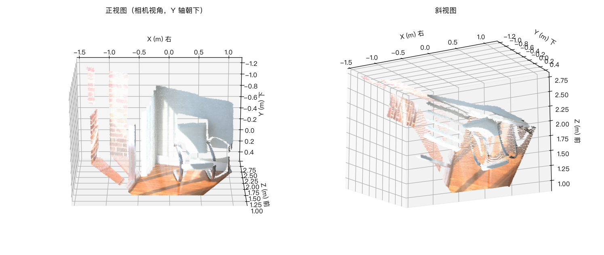
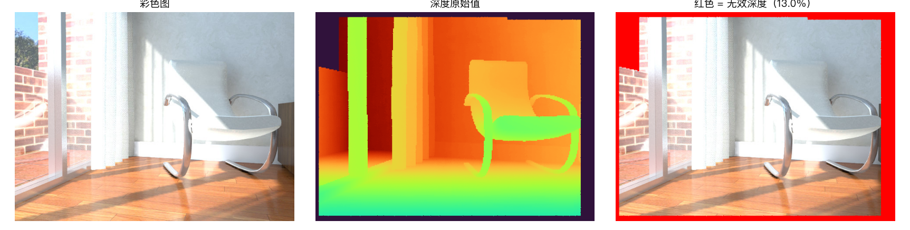
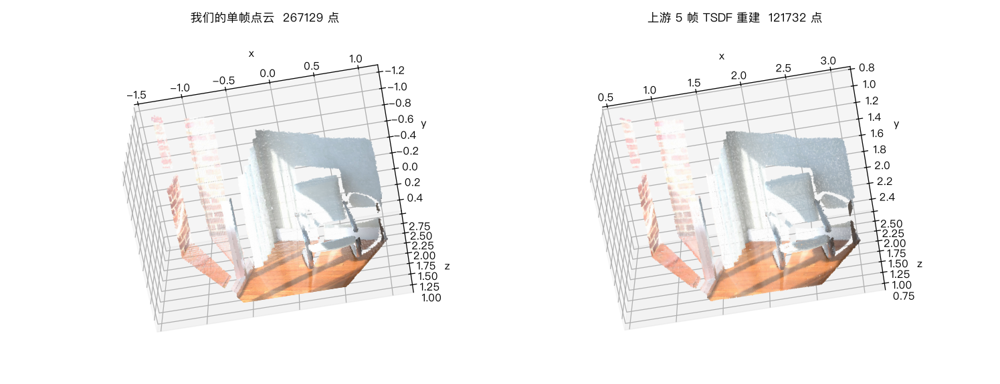
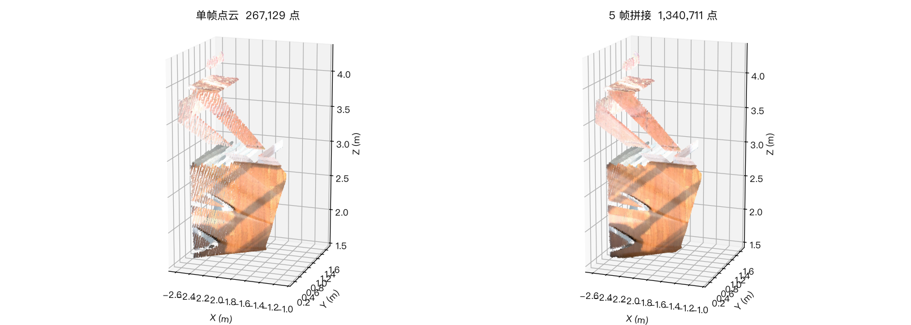

# RGB-D 几何工具箱

用 NumPy 和 Open3D 从零实现针孔相机模型的几何链路：投影、反投影、
点云生成、刚体变换、一致性检查，并在真实的 RGB-D 数据上验证。

投影、反投影、刚体变换三个核心函数都是自己实现的，没有直接调用库的对应功能。
每一步都配了可执行的检查，用已知答案、理论公式或独立实现交叉验证。

## 环境

Python 3.11，依赖见 requirements.txt。

```bash
mamba create -n rgbd -c conda-forge python=3.11 numpy matplotlib -y
conda activate rgbd
pip install -r requirements.txt

# macOS 额外一步：Open3D 依赖系统库 libusb，缺少时 import open3d 会失败
brew install libusb
```

## 运行

```bash
conda activate rgbd
python work/01_pixel_and_index.py     # 依次运行；04 之后需要先准备数据
```

数据获取方式见 notes/dataset.md，产出写在 outputs/。查看点云：

```bash
python tools/view_pointcloud.py outputs/05_pointcloud_frame0.ply
python tools/view_pointcloud.py outputs/*.ply --axes   # 多个一起看
```

`.ply` 体积较大，已排除在版本控制外，需要时用脚本重新生成。

## 结构

```
├── work/      9 个脚本，按编号顺序，对应下面验证表里的各项
├── tools/     view_pointcloud.py，在 Open3D 窗口里查看点云
├── notes/     dataset.md 数据卡 / learning-log.md 学习日志
└── outputs/   点云文件与效果图
```

代码检查与格式化用 ruff，配置在 pyproject.toml：`ruff check .` 与 `ruff format .`。

## 验证结果

每一条都找了独立参照，不是跑通就算对。

| 检查项 | 结果 | 参照 |
|---|---|---|
| 反投影与 Open3D 逐点比对（26.7 万点） | 1.18e-07 m | 独立实现 |
| 点云颜色与 Open3D 比对 | 0.00e+00 | 独立实现 |
| 点数与深度图有效像素数 | 267129，一致 | 另一条统计路径 |
| 投影与反投影往返（真实点云） | 2.22e-16 m | 互逆性 |
| 刚体变换保持点间距离（500 对点） | 8.88e-16 m | 数学不变量 |
| 变换与 Open3D 比对 | 0.00e+00 | 独立实现 |
| 像素量化误差（2 m 处） | 中位数 1.27 mm | 理论值 0.408·Z/fx，差 5% 内 |
| 相机位姿方向判定 | 12.84 mm 对 60.33 mm | 帧间自洽性 |

## 效果

| 单帧点云（26.7 万点） | 无效深度分布（13%） |
|---|---|
|  |  |

| 单帧与上游 5 帧重建对比 | 按给定相机位姿拼接 5 帧 |
|---|---|
|  |  |

## 已知限制

- 只做单帧几何；不实现配准，位姿由数据集提供，也没有评估位姿精度
- 内参用的是 Open3D 示例里的通用参数，不是针对设备标定的
- 数据集 5 帧相机累计只移动 97.9 mm，拼接主要让点变密，没扩大覆盖范围

## 核心结论

- 数组下标与像素坐标相反：「像素 (u, v)」对应 `arr[v, u]`
- 程序不报错不等于结果正确：行列互换、深度单位、坐标系约定都属于
  「能跑完但算错」，必须靠主动设计的检查发现
- 一致性检查只证明两个函数互逆，不能证明参数正确 ——
  用错误内参做往返，误差依然是 2e-16
- 单视角点云是一层壳：每个像素只贡献一个深度，背面与被遮挡处没有数据
- 一个像素的误差约等于 Z / fx 米，可直接用来估算定位精度
